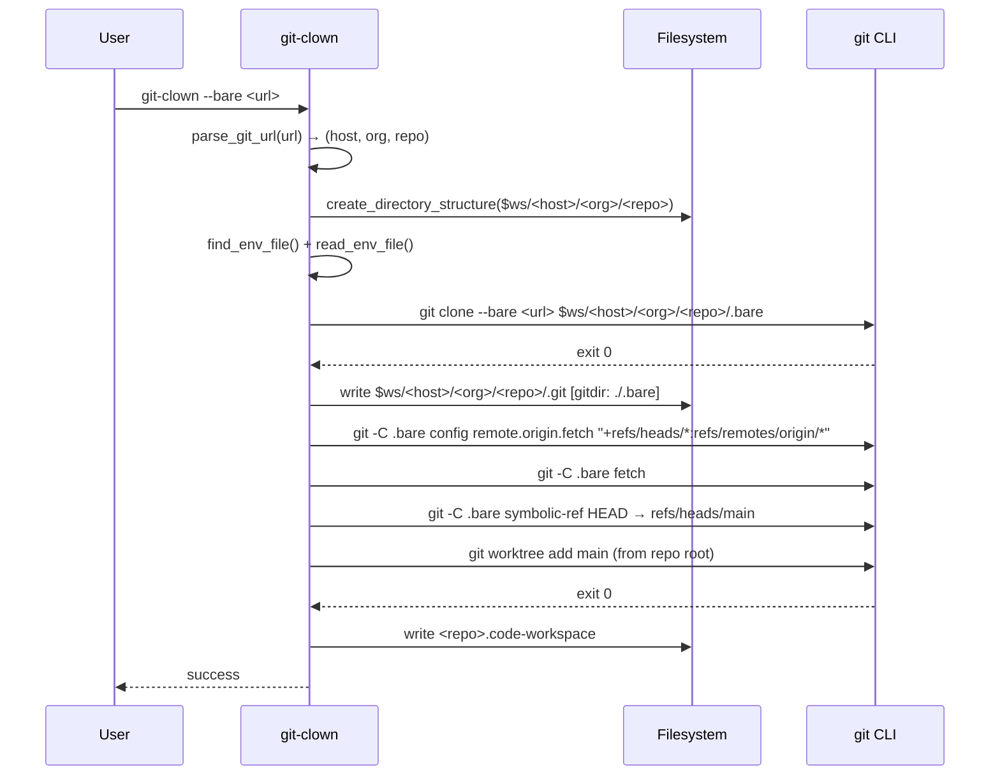

## Context

`git-clown` currently clones a repository directly into a structured directory tree (`$WORKSPACE_ROOT/<host>/<org>/<repo>/`). Developers who use git worktrees need a different layout: a bare clone to hold the object store, plus named subdirectories per branch. Setting this up manually requires running five or more git commands in the right order and knowing a non-obvious trick (the `.git` pointer file). This change adds a `--bare` flag that automates the entire setup.

Current state: one clone mode, one directory layout, no worktree awareness.

## Goals / Non-Goals

**Goals:**
- Add `--bare` flag that clones a repo as bare and sets up an initial worktree for the default branch.
- Keep the existing non-bare clone path completely unchanged.
- Wire up the remote fetch refspec fix that bare clones require.
- Create a `<repo>.code-workspace` file so the directory opens well in VS Code.
- Auto-detect the default branch (`main` → `master` → HEAD fallback).

**Non-Goals:**
- Managing additional worktrees beyond the initial default-branch one.
- Deleting or garbage-collecting existing worktrees.
- Changing the non-bare directory layout.
- Supporting shallow bare clones (out of scope for this change).

## Decisions

### D1 — Directory layout for the bare repo

**Decision:** Clone bare into `$WORKSPACE_ROOT/<host>/<org>/<repo>/.bare` and place the `.git` pointer file at `$WORKSPACE_ROOT/<host>/<org>/<repo>/.git`.

**Rationale:** Keeps the `.bare` hidden (dot-prefixed) so it is not confused with a worktree. The `.git` pointer at the repo root lets tools like VS Code and shell prompts treat the whole directory as a git repo without needing to know about the bare internals.

**Alternatives considered:**
- Separate top-level `bare/` tree (e.g., `$WORKSPACE_ROOT/bare/<host>/<org>/<repo>/`): rejected because it splits the repo into two distant locations, making it harder to reason about and harder to express in the `.git` pointer file path.

### D2 — Refspec fix

**Decision:** After bare clone, set `remote.origin.fetch = "+refs/heads/*:refs/remotes/origin/*"` via `git config` inside `.bare`, then run `git fetch`.

**Rationale:** `git clone --bare` omits the fetch refspec by default, meaning `git fetch` will not populate `refs/remotes/origin/*`. Without this fix, commands like `git log origin/main` and worktree operations that reference remote branches silently fail.

### D3 — Default branch detection

**Decision:** Read `HEAD` from the bare repo using `git -C .bare symbolic-ref HEAD`, parse the branch name, and fall back to `master` if the ref cannot be resolved.

**Rationale:** This is the authoritative way to determine what the server considers the default branch without an extra network call.

### D4 — Worktree add command

**Decision:** Run `git worktree add <branch>` from the repo root directory (not from inside `.bare`).

**Rationale:** Running from the repo root means the worktree path is relative and resolves correctly to `$WORKSPACE_ROOT/<host>/<org>/<repo>/<branch>/`. Running from `.bare` would require an absolute path and skips the `.git` pointer file resolution.

### D5 — VS Code workspace file

**Decision:** Write `<repo>.code-workspace` with `{"folders":[{"path":"."}],"settings":{}}` at the repo root.

**Rationale:** Opening `"path": "."` (the repo root) gives VS Code access to the `.bare` directory and all worktree subdirectories in one workspace, enabling cross-worktree file search and refactoring. A per-worktree workspace file would require regeneration each time a new worktree is added.

### D6 — Reuse existing env-file and directory-creation logic

**Decision:** The `--bare` path reuses `find_env_file`, `read_env_file`, and `create_directory_structure` unchanged.

**Rationale:** The env loading and directory creation concerns are identical in both modes. No duplication needed.

## Risks / Trade-offs

- **`.bare` naming collision** → If the user already has a file or directory named `.bare` at the repo root, the clone will fail. Mitigation: check for existence before cloning and emit a clear error.
- **Branch detection failure on empty repos** → Repos with no commits have no `HEAD`. Mitigation: detect this case and exit with a helpful message instead of creating a broken worktree.
- **`git worktree add` requires git ≥ 2.5** → Most modern systems satisfy this, but no version check is performed. Mitigation: document the requirement in the README; the git command itself will fail with a clear message on old versions.
- **Hardcoded `main`/`master` fallback order** → Some repos use other default names. Mitigation: `symbolic-ref HEAD` reads the actual default, so the fallback only fires when the ref is unresolvable (empty repo or corrupted HEAD), which is already an error condition.

## Sequence Diagram

