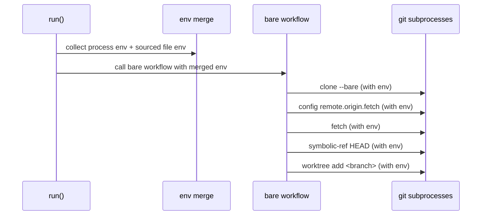

## Context

The application merges inherited process environment with file-sourced variables from .envrc or .env before running git clone. However, parts of the bare workflow create additional git subprocesses without consistently applying that merged environment. In environments where git behavior depends on variables such as transport, proxy, credentials, or SSH command overrides, this inconsistency can cause post-clone failures.

Stakeholders are developers relying on reproducible cloning and worktree setup for repositories that require non-default git environment configuration.

## Goals / Non-Goals

**Goals:**
- Ensure every git subprocess launched by git-clown receives the same merged environment map.
- Remove per-function drift by introducing a shared helper for git command construction and env application.
- Preserve existing precedence: sourced file variables override inherited process environment.
- Keep behavior unchanged for users without env files.

**Non-Goals:**
- Changing CLI flags, output format, or repository layout behavior.
- Introducing new configuration files or environment parsing rules.
- Reworking unrelated clone/worktree logic.

## Decisions

1. Centralize git command setup in one helper.
- Decision: Add a helper that builds a tokio git command (current_dir, args) and applies all env vars before execution.
- Rationale: Avoids repeating env injection logic in each git operation and prevents regressions when new commands are added.
- Alternative considered: Keep per-call loops for command.env insertion. Rejected because it is error-prone and already led to inconsistent behavior.

2. Pass env vars through all bare-workflow steps.
- Decision: Update clone_bare, fix_refspec_and_fetch, detect_default_branch, and add_worktree to accept env vars and apply them.
- Rationale: These are all git subprocess boundaries and must receive the same runtime environment contract.
- Alternative considered: Apply env only to clone/fetch. Rejected because symbolic-ref/config/worktree may also depend on env setup in some environments.

3. Add tests for propagation behavior.
- Decision: Add or adapt tests to verify all git subprocess invocations are wired to the shared env path.
- Rationale: Prevent future regressions when adding new git commands.

Sequence overview:

## Risks / Trade-offs

- [Risk] Refactor could miss one git subprocess path.
  - Mitigation: Use a shared helper and update all command-call sites in one change.
- [Risk] Additional function parameters increase signature complexity.
  - Mitigation: Use references and consistent parameter ordering to keep call sites readable.
- [Trade-off] Slightly more abstraction around command construction.
  - Mitigation: Keep helper small and focused on env application only.

## Migration Plan

1. Add shared helper for constructing git commands with env vars.
2. Update all git subprocess functions to use helper and accept env vars where missing.
3. Run tests and validate bare and normal clone paths.
4. Roll back by reverting helper integration if unexpected behavior is found.

## Open Questions

- Should this change also include a lightweight lint/check to enforce env application for future git subprocess additions?
