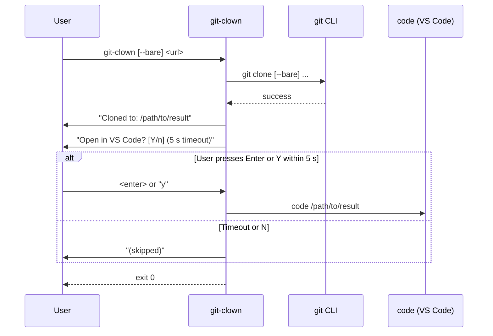

## Context

`git-clown` currently exits after a successful clone with no user-facing output beyond the raw `git` process streams. The result path is implicit (derived from the URL) and the user must know the workspace layout to find it. This change adds a result-path summary line and an optional "open in VS Code" prompt at the end of every successful run.

The tool uses Tokio for async I/O and already imports `tokio = { features = ["full"] }`, so `tokio::time::timeout` and `tokio::io::AsyncBufReadExt` are available at no extra cost.

## Goals / Non-Goals

**Goals:**
- Print the final result directory (clone dir for standard mode, worktree dir for bare mode) to stdout after success.
- Prompt the user to open that directory in VS Code; auto-dismiss after 5 seconds if no input.
- Keep the implementation self-contained in `src/main.rs` with no new crate dependencies.

**Non-Goals:**
- Detecting whether VS Code (`code`) is installed — if it is not, the `code` invocation will fail naturally and the error can be ignored.
- Changing existing git output (stdout/stderr from git commands remain unmodified).
- Persisting the user's preference (always prompt; no config file).

## Decisions

### D1 — Path to print in standard clone mode

**Decision:** Print `<workspace_root>/<host>/<org>/<repo>` — the directory `git clone` placed the repo into.

**Rationale:** That is the canonical location the user needs to `cd` into. The `dir_path` variable in `run()` already holds `<ws>/<host>/<org>`; appending `repo` gives the clone destination.

### D2 — Output for bare clone mode

**Decision:** Print two lines to stdout:
1. `Worktree: <workspace_root>/<host>/<org>/<repo>/<branch>` — so the user knows where to `cd` and start working.
2. `Workspace: <workspace_root>/<host>/<org>/<repo>/<repo>.code-workspace` — so the user knows the VS Code entry point for multi-worktree use.

The `code` invocation (if the user confirms the prompt) SHALL open the `.code-workspace` file, not the worktree directory.

**Rationale:** The user who chose `--bare` intends to work across multiple branches simultaneously. Opening the workspace file gives VS Code visibility of all worktrees from the start. Printing both paths removes ambiguity: the worktree path answers "where do I work now?", the workspace path answers "how do I open this in VS Code properly?". The two-line output is additive — the standard clone path is unchanged.

### D3 — Timeout mechanism

**Decision:** Use `tokio::time::timeout(Duration::from_secs(5), read_line_async())` wrapping an async read from stdin.

**Rationale:** Tokio's timeout is the simplest approach given the existing async runtime. Alternatives considered:
- `std::thread::spawn` + channel with a blocking `read_line`: works but mixes sync/async awkwardly.
- A separate `ctrlc`/signal crate: overkill for a simple line-read timeout.
- `select!` on a timer and stdin future: equivalent but more verbose; `timeout` wrapper is cleaner.

### D4 — Default behaviour on timeout or "n" input

**Decision:** Timeout and `n`/`N` both silently skip the `code` invocation; the process exits 0.

**Rationale:** Non-interactive use (shell scripts, CI) must not hang. A 5-second timeout with a no-op default is safe. Printing a brief "(timed out, skipping)" message avoids silent confusion in interactive use.

### D5 — Prompt output goes to stdout

**Decision:** The prompt line and the path summary both go to stdout (via `println!`), not the logger.

**Rationale:** These are user-facing result messages, not debug/info log lines. They should always appear regardless of `RUST_LOG` level and should be easily captured by shell scripts.

### D6 — `run_bare_clone` returns the worktree path

**Decision:** Change the return type of `run_bare_clone` from `Result<(), GitClownError>` to `Result<PathBuf, GitClownError>`, returning the worktree path so `run()` can print it.

**Rationale:** The worktree path is computed inside `run_bare_clone` (after branch detection). Propagating it upward avoids recomputing it in `run()`.

### D7 — TTY guard gates the entire prompt

**Decision:** Before showing the VS Code prompt, check `std::io::stdin().is_terminal()`. If stdin is not a TTY, skip the prompt entirely and exit immediately after printing the `Cloned to:` line.

**Rationale:** `std::io::IsTerminal` is stable since Rust 1.70 (project uses 1.93.1) — no new dependency required. Non-interactive callers (CI, shell scripts, piped use) should never see a prompt or incur any delay. The TTY guard makes this a hard guarantee rather than relying solely on the 5-second timeout. When stdin is non-TTY, `tokio::io::stdin()` returns EOF immediately anyway, but the explicit guard is clearer and avoids spawning the background thread Tokio uses for stdin reads.

**Alternatives considered:**
- Rely on timeout alone (no TTY check): safe but wastes a thread and adds latency in non-interactive piped use.
- `is-terminal` crate: unnecessary; `std::io::IsTerminal` covers all platforms since Rust 1.70.

## Risks / Trade-offs

- **stdin not a TTY** → Fully mitigated by D7: the prompt is skipped entirely for non-TTY stdin.
- **`code` CLI not on PATH** → `code` invocation silently fails. Mitigation: log a `warn!` if the spawn fails so the user knows; do not treat it as a fatal error.
- **Async stdin on Windows** → `tokio::io::stdin()` works on Windows in the Tokio full runtime. No special handling needed.

## Sequence Diagram

