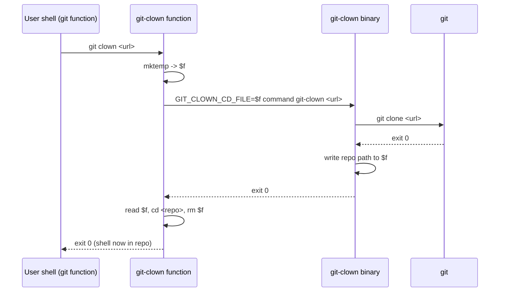

## Context

`git-clown` runs as a child of the user's shell (directly, or through git as `git clown`), so it cannot change the shell's working directory. Tools like zoxide and direnv solve this with shell functions loaded from the rc file via `eval "$(tool init <shell>)"`.

## Decisions

### D1: Hand off the path through a file, not stdout
The wrapper creates a temp file with `mktemp` and runs `GIT_CLOWN_CD_FILE=<file> command git-clown "$@"`. After a successful clone the binary writes the absolute path into it. Parsing stdout would interfere with git's output and with users who pipe it. A file is unaffected by logging and works whatever `RUST_LOG` is.
The file holds the exact path bytes with no terminator, and the wrapper reads the whole file (`$(cat f; printf x)`, then strips the `x`), so paths containing newlines survive.

### D1b: git-clown names the clone directory
The plain clone runs `git clone <url> <name>`, with `<name>` derived the way git derives it: the last URL path segment without `.git`. The directory that is checked for an existing clone, cloned into, and reported to the wrapper is therefore always the same, also for nested namespaces such as `org/subgroup/repo`, which land in `<host>/org/repo`.

### D1c: Safe under strict shell options
The functions expand arguments as `${1+"$@"}` and test `${1-}`, and initialize every local, so they work with `set -u` (including bash 3.2) and `set -e`.

### D2: `eval "$(git-clown init <shell>)"` in the rc file
The rc block only evaluates the script the binary prints, so upgrading the binary also upgrades the functions. The block checks `command -v git-clown` first, so a missing binary does not break shell startup.

### D3: Wrap `git` as well as `git-clown`
`git clown` is the main way people run the tool. A `git` function sends the `clown` subcommand to the `git-clown` function and calls `command git` for everything else. It is declared as `function git { ... }` so that an existing `alias git=...` is not expanded at definition time.

### D4: Doctor self-test runs the real wrapper
Doctor runs `bash --norc --noprofile -c` / `zsh -f -c` with the init script and calls the hidden `__selftest-cd <dir>` subcommand through both `git-clown` and `git clown`, then compares `$PWD`. This tests what users rely on, without touching their rc files.

### D5: The wrapper tells the binary it is there
The wrapper also sets `GIT_CLOWN_SHELL=<shell>`. When doctor runs through the wrapper, it can report that the integration is loaded in the current session. Exported functions cannot be seen from a child process.

### D5b: Doctor trusts only its own block and the real shell
Doctor does not try to parse lines the user wrote (comments can hide inside quotes and command substitutions). It recognises only the exact managed block. A setup done by hand is recognised at runtime, through the wrapper's `GIT_CLOWN_SHELL`. The shell itself checks the rc file's syntax with `-n`, because a syntax error anywhere stops the rest of the file, including the block, from running.

### D6: crossterm only for the prompt
The doctor report is plain line output, so it stays in scrollback and works when piped. A full-screen ratatui view would get in the way. crossterm's raw mode reads one key for `[y/N]`. The prompt only appears when stdin and stdout are terminals.

## Sequence

## Risks / Trade-offs

- **Users with their own `git` function**: whichever is defined last wins. The README explains how to chain them.
- **fish and other shells**: not supported yet. Doctor reports them as unsupported.
